<p align="center">
  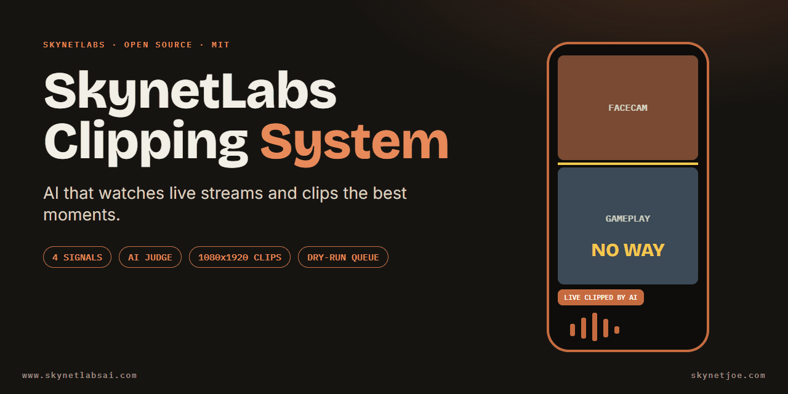
</p>

# SkynetLabs Clipping System

**AI that watches live streams and clips the best moments.**

[](LICENSE)
[](#3-requirements)
[](#10-publish-queue-and-connecting-accounts)
[](docs/Live-Stream-Clipping-Starter-Guide.pdf)

Built by [SkynetLabs](https://www.skynetlabsai.com) (repo name: `skynet-live-clipper`). Free and MIT licensed.

## In 30 seconds

It watches a live stream (or a recording), reads four signals every second (chat speed, hype words, audio energy, speech), asks an AI judge which moments are worth a Short, and renders each one as a branded 1080x1920 clip with captions, a hook title and a cover. You review the clips in a local dashboard. Publishing is a separate queue that is **dry run by default**.

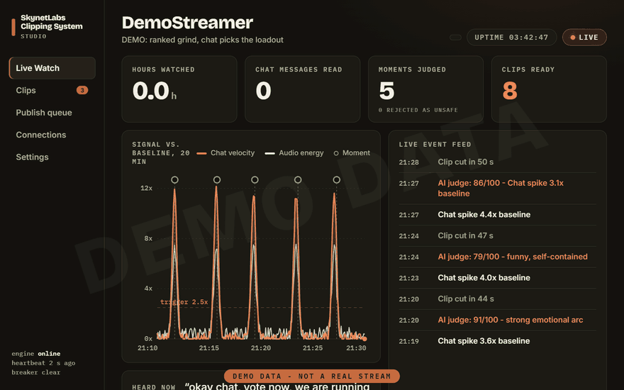

*A short tour of the Studio dashboard, recorded on built-in synthetic demo data (not a real stream).*

## Quick start

```bash
git clone https://github.com/waseemnasir2k26/skynet-live-clipper.git
cd skynet-live-clipper
pip install -r requirements.txt
python run.py --live https://www.youtube.com/watch?v=VIDEO_ID --profile light   # or drop --profile light if you have an NVIDIA GPU
python studio/server.py                                                          # dashboard: http://127.0.0.1:8790
```

You need `ffmpeg` and `yt-dlp` on PATH (details in [Requirements](#3-requirements)). Only clip streams you have permission to clip ([why](#17-only-clip-streams-you-have-permission-to-clip)).

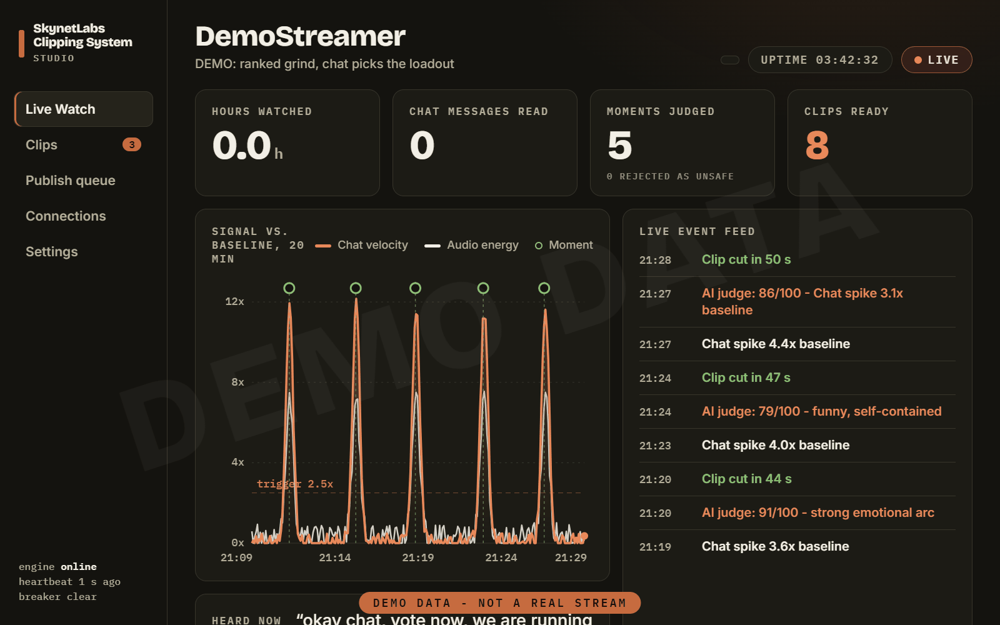

*Studio overview with demo data: counters, the signal graph with detected moments, and the live event feed.*

## Feature grid

| | |
|---|---|
| **4 signals** | chat velocity, hype words, audio energy, speech (faster-whisper) against rolling baselines |
| **AI judge** | strict-JSON verdict with a safe flag, sees 5 frames of the window; deterministic fallback if unavailable |
| **9:16 renderer** | facecam on top, action below, word-timed captions, hook title, credit card, -14 LUFS, cover image |
| **Studio dashboard** | local, standard-library server on 127.0.0.1: review, approve, reject, edit captions |
| **Publish queue** | 5 destinations, hard caps, spacing, posting window, circuit breaker, idempotent ledger. **Dry run by default** |
| **Safety** | step, wall-clock and LLM-call caps, disk guard, STOP file halts everything |
| **Light mode** | small model on CPU for a 4 vCPU / 8 GB box (not tested end to end) |
| **Channel watcher** | starts the engine when a channel goes live |

## Honest status (read this)

- The test was a **replay of a recording** (2.5 h of a public stream fed through the real-time path), not a full unattended live run.
- **Publishing is dry run only.** Nothing has been posted by this system. Real uploaders are not included.
- Twitch and Kick, the Linux install and light mode end to end are untested. Details in [section 2](#2-honest-status-proven-vs-not-proven).

## Links

- Website: [www.skynetlabsai.com](https://www.skynetlabsai.com) | [skynetjoe.com](https://skynetjoe.com)
- WhatsApp: [+62 813 1607 7185](https://wa.me/6281316077185)
- Free guide (PDF): [`docs/Live-Stream-Clipping-Starter-Guide.pdf`](docs/Live-Stream-Clipping-Starter-Guide.pdf)
- Playbook (deeper, paid, Etsy): [The AI Stream Clipper Playbook](https://www.etsy.com/listing/4624484141)

---

## Contents

1. [What it does](#1-what-it-does)
2. [Honest status: proven vs not proven](#2-honest-status-proven-vs-not-proven)
3. [Requirements](#3-requirements)
4. [Install](#4-install)
5. [Config walkthrough](#5-config-walkthrough)
6. [Run on a live URL](#6-run-on-a-live-url)
7. [Run on a recorded file (replay)](#7-run-on-a-recorded-file-replay)
8. [Channel watcher](#8-channel-watcher)
9. [The Studio dashboard](#9-the-studio-dashboard)
10. [Publish queue and connecting accounts](#10-publish-queue-and-connecting-accounts)
11. [Safety caps and the STOP breaker](#11-safety-caps-and-the-stop-breaker)
12. [Light mode (no GPU)](#12-light-mode-no-gpu)
13. [Output files](#13-output-files)
14. [Tests](#14-tests)
15. [Troubleshooting](#15-troubleshooting)
16. [FAQ](#16-faq)
17. [Only clip streams you have permission to clip](#17-only-clip-streams-you-have-permission-to-clip)
18. [Licence](#18-licence)

---

## 1. What it does

```
live URL --> yt-dlp + ffmpeg --> 10 s segments --+--> audio loudness per second ---+
live chat (yt-dlp) -----------------------------+--> chat velocity + hype words ---+--> rolling z-scores --> spike --> candidate
                                                 +--> faster-whisper speech-to-text +                                  |
                                                                                                                       v
        clips/<id>/clip.mp4 + cover.jpg + meta.json <-- render (NVENC or x264) <-- LLM judge (strict JSON, sees 5 frames)
```

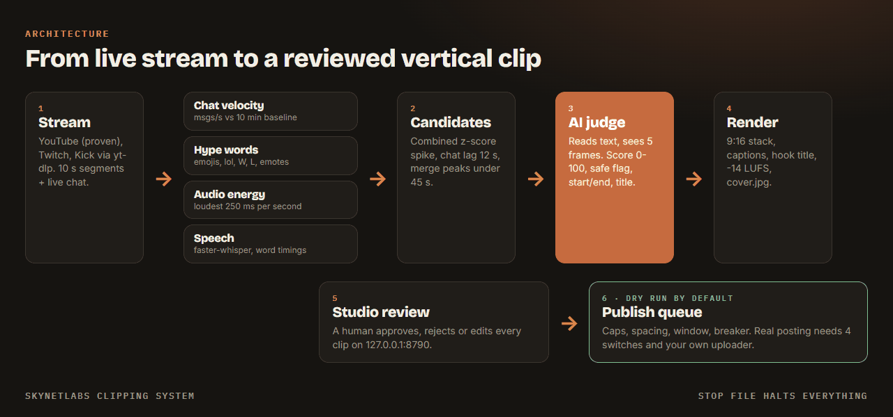

*Architecture: every step from the live stream to the dry-run publish queue.*

1. **Ingest.** Captures a live URL with yt-dlp into 10-second MPEG-TS segments and downloads the live chat. Or follows a recording file.
2. **Four signals, every second of stream time.**
   - chat messages per second against a 10-minute rolling baseline (robust z-score),
   - hype words and emotes in chat (laughing emojis, "lol", "W", "L", channel emotes, superchats count 5x),
   - audio loudness (loudest 250 ms of each second) against its own baseline,
   - speech: faster-whisper transcribes the audio with word timestamps.
3. **Candidates.** A combined score crosses a threshold and becomes one candidate per spike. Chat-led peaks are shifted back by the viewer reaction lag (12 s). If nothing fires for 5 minutes, the best window in that span is still judged, so quiet stretches are not ignored.
4. **LLM judge.** A headless `claude -p` call (Haiku by default) reads the transcript window, loudness peaks, chat bursts and chat text, and opens 5 frames from the window to see the screen. It returns strict JSON: score 0-100, reason, start/end (20-55 s, hook first), title, caption, hashtags and a `safe` flag. Sexual or otherwise unsuitable windows are rejected. If the CLI is missing, fails, or the hourly cap is hit, a deterministic signal-based score is used instead and marked in `reasons`.
5. **Cut and design.** Finds the facecam once per stream (OpenCV YuNet face detector, or set it by hand), then renders a stacked layout: zoomed facecam on top, gameplay below, a divider, word-timed captions (2-3 words, active word highlighted), a hook title for the first 2.6 s, a "clipped by AI" credit card, loudness normalised to -14 LUFS, and a designed `cover.jpg`.
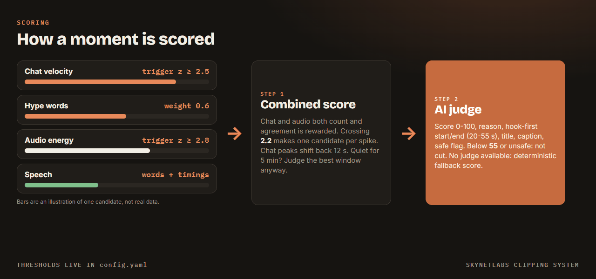

*How a moment is scored. Thresholds are the defaults in `config.yaml`; the bars are an illustration.*

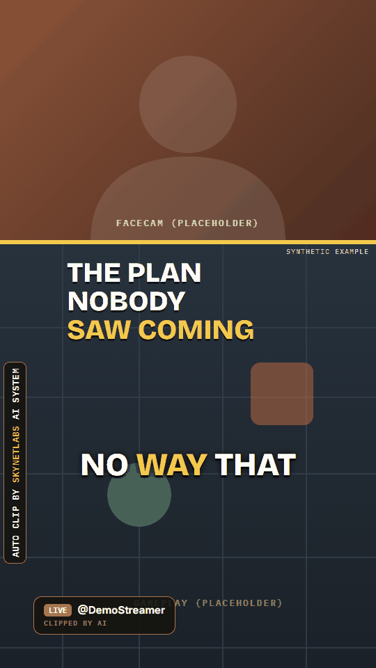

*The clip layout on a synthetic placeholder (no real stream or person): left sidebar, hook title, word-timed captions, credit card.*

6. **Nothing is published by the engine.** Clips land in a folder. Publishing is a separate, opt-in queue (section 10).

## 2. Honest status: proven vs not proven

All numbers below are from one recorded test on 2026-11-24.

**Proven**

| What                                                         | Result                                                              |
| ------------------------------------------------------------ | ------------------------------------------------------------------- |
| Replay of a recorded 2.5 h stream through the real-time path | 23,655 chat messages processed                                      |
| Moments judged by the vision LLM                             | 81                                                                  |
| Rejected as unsafe                                           | 10                                                                  |
| Clips rendered                                               | 14, all 1080x1920, no errors                                        |
| Time from moment to finished clip                            | about 49 s on average (min 37 s, max 68 s), measured in replay time |
| Render time per clip                                         | 17-25 s on an NVIDIA GPU (NVENC)                                    |
| Live capture of a real YouTube live stream                   | captured and read chat (a short smoke run)                          |
| Unit tests                                                   | 29 pass                                                             |

**Important caveats**

- The 2.5 h run was a **replay of a recording fed through the real-time path** (state shows `mode: replay`, never `live`). It is not a fully unattended live run over a whole stream.
- **Publishing was dry run only.** No clip from this system has been posted by the publish queue. The five destination adapters are validated and dry-run tested, but the real upload scripts are not included (section 10).
- Of the 14 test clips, about 4 were good, 5 fine and 5 weak. The stream was mostly driving and missions. Quality depends on the stream.
- Captions come from speech-to-text on a loud game mix, so some words are wrong. The test language was Hindi (with a Roman-letter transliteration). English uses the same path but was not part of the recorded run.

**Not tested:** Twitch and Kick (same yt-dlp path as YouTube, but never run), the Linux install script and systemd unit, the automatic switch to light mode at a set time, and CPU-only light mode end to end.

## 3. Requirements

| Item             | Needed                          | Notes                                                                                                                                                   |
| ---------------- | ------------------------------- | ------------------------------------------------------------------------------------------------------------------------------------------------------- |
| OS               | Windows 10/11 (tested) or Linux | Linux/VPS path is written but untested                                                                                                                  |
| Python           | 3.10 or newer                   | engine tested on 3.11, unit tests also on 3.13                                                                                                          |
| ffmpeg + ffprobe | yes, on PATH                    | needs the `libass` subtitle filter; a recent full build has it. NVENC build optional                                                                    |
| yt-dlp           | yes, on PATH                    | for live URLs, chat download and channel polling                                                                                                        |
| GPU              | optional                        | NVIDIA GPU gives CUDA speech-to-text (`large-v3`) and NVENC rendering. Without one use light mode (section 12)                                          |
| LLM judge        | optional                        | the [Claude Code](https://docs.claude.com/en/docs/claude-code) CLI as `claude` on PATH, logged in. Without it the deterministic fallback scores moments |
| Disk             | 40+ GB free recommended         | the capture guard stops below `ingest.min_free_gb` (40 by default)                                                                                      |
| RAM              | 8 GB minimum                    | light mode targets 4 vCPU / 8 GB                                                                                                                        |

Python packages (see `requirements.txt`): numpy, pyyaml, pillow, opencv-python-headless, faster-whisper. The Studio and the publish queue use only the standard library.

## 4. Install

```bash
git clone https://github.com/waseemnasir2k26/skynet-live-clipper.git
cd skynet-live-clipper
python -m venv .venv
# Windows:  .venv\Scripts\activate        Linux/macOS:  source .venv/bin/activate
pip install -r requirements.txt
```

Check the tools:

```bash
ffmpeg -version
ffprobe -version
yt-dlp --version
claude --version        # optional (LLM judge)
python -m pytest -q     # optional: 29 tests
```

For CUDA speech-to-text on Windows, install the NVIDIA runtime wheels in the same environment: `pip install nvidia-cublas-cu12 nvidia-cudnn-cu12`. If CUDA fails at run time the engine falls back to CPU int8 and logs it.

Linux/VPS (untested): `sudo bash deploy/install.sh`, then edit `/opt/skynet-live-clipper/config.vps.yaml` and `systemctl enable --now skynet-live-clipper`.

## 5. Config walkthrough

Everything lives in `config.yaml`. The engine hot-reloads it every minute, so caps can be tightened without a restart. Relative paths are relative to the repo folder.

| Section  | What to set                                                                                                                                                                     |
| -------- | ------------------------------------------------------------------------------------------------------------------------------------------------------------------------------- |
| `source` | `mode` (`live` or `file`), `url`, `streamer` and `credit` (shown on the clip card and in captions), `file` / `chat_file` for recordings, `live_format` (yt-dlp format selector) |
| `paths`  | `data_root` (default `data`), `out_root`, `stop_file`, `render_lock`                                                                                                            |
| `ingest` | `segment_seconds`, `keep_segments_hours` (old segments are pruned), `min_free_gb` (disk guard)                                                                                  |
| `detect` | thresholds for chat, audio and combined score, `chat_lag_s`, `window_before_s` / `window_after_s`, `min_gap_s`, `quiet_sample_every_s`                                          |
| `asr`    | `model` (`large-v3`), `device` (`cuda` or `cpu`), `compute_type`, `language` (any faster-whisper code, default `en`)                                                            |
| `judge`  | the LLM command, `frames` it looks at, `timeout_s`, `max_calls_per_hour`, `max_calls_per_stream`, `min_score` (clips below it are not cut)                                      |
| `clips`  | `max_per_hour`, `min_len` / `max_len`, watermark text, `hook_seconds`                                                                                                           |
| `render` | size, encoder (`h264_nvenc` with `libx264` fallback), loudness, `layout` (`stack`, `pip`, `center`), `facecam_override` as `[x, y, w, h]` in source pixels                      |
| `safety` | `max_steps`, `max_wall_hours`, `full_power_until`, `light_mode` settings                                                                                                        |

Start by setting `source.streamer` and `source.credit`, then pick `source.mode`.

Optional environment variables (see `.env.example`; nothing reads a `.env` file automatically, export them in your shell): `CLIPPER_CREDIT`, `CLIPPER_ROOT`, `CLIPPER_SECRETS`, `STUDIO_PORT`, `AUTO_PUBLISH`, `CLIPPER_COPYRIGHT_CHECK`.

## 6. Run on a live URL

```bash
python run.py --live https://www.youtube.com/watch?v=VIDEO_ID
python run.py --live https://www.youtube.com/watch?v=VIDEO_ID --profile light   # no GPU
```

YouTube is the proven path. Twitch and Kick URLs go through the same yt-dlp code but are untested. The engine writes `data/out/state.json` every 5 seconds and the clips to `data/out/clips/`. Stop cleanly with the STOP file (section 11).

## 7. Run on a recorded file (replay)

Replay feeds a recording through the exact real-time path (ffmpeg `-readrate`, chat released only when the video reaches it). It is always labelled `replay`, never `live`.

```bash
# 1) record or download the stream and its chat (you need permission, section 17)
yt-dlp -o capture.mp4 "https://www.youtube.com/watch?v=VIDEO_ID"
yt-dlp --skip-download --write-subs --sub-langs live_chat -o capture "https://www.youtube.com/watch?v=VIDEO_ID"

# 2) replay it at real time, or faster with --replay-rate 3
python run.py --file capture.mp4 --chat capture.live_chat.json --vod --replay --replay-from 0 --replay-rate 3
```

Other file modes:

- `--file X --vod` processes a finished file as fast as the machine allows (chat timed by video offset).
- `--file X` alone follows a file that is still growing.

## 8. Channel watcher

```bash
python watch.py --channel https://www.youtube.com/@SomeChannel --every 300
```

Polls `<channel>/live` with one metadata-only yt-dlp call, starts `run.py --live <url>` when the channel goes live, and goes back to polling when the engine exits. It never starts a second engine and has caps on polls, hours and engine starts per day. Log: `data/watch.log`. Stop only the watcher with a `data/WATCH-STOP` file.

## 9. The Studio dashboard

```bash
python studio/server.py        # http://127.0.0.1:8790
```

The Studio is a single local page (standard library server, bound to `127.0.0.1` only, with Host and Origin checks). It reads the engine output and lets you review clips.

| Section       | What it shows                                                                                                          |
| ------------- | ---------------------------------------------------------------------------------------------------------------------- |
| Live Watch    | status, hours watched, chat read, moments judged, clips ready, the signal graph with moments marked, a live event feed |
| Clips         | every clip with score, reasons and a player; approve, reject or edit the caption                                       |
| Publish queue | approved clips scheduled per destination, with a dry-run button                                                        |
| Connections   | which destinations have a credential file and an uploader script                                                       |
| Settings      | caps, spacing, posting window, auto-publish switch (simulated, see section 10)                                         |

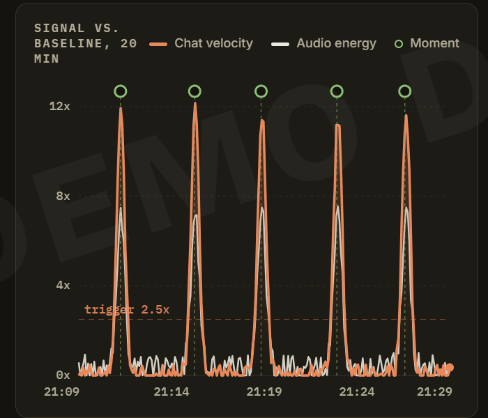

*Moments timeline: chat and audio against baseline; each green circle is a detected moment.*

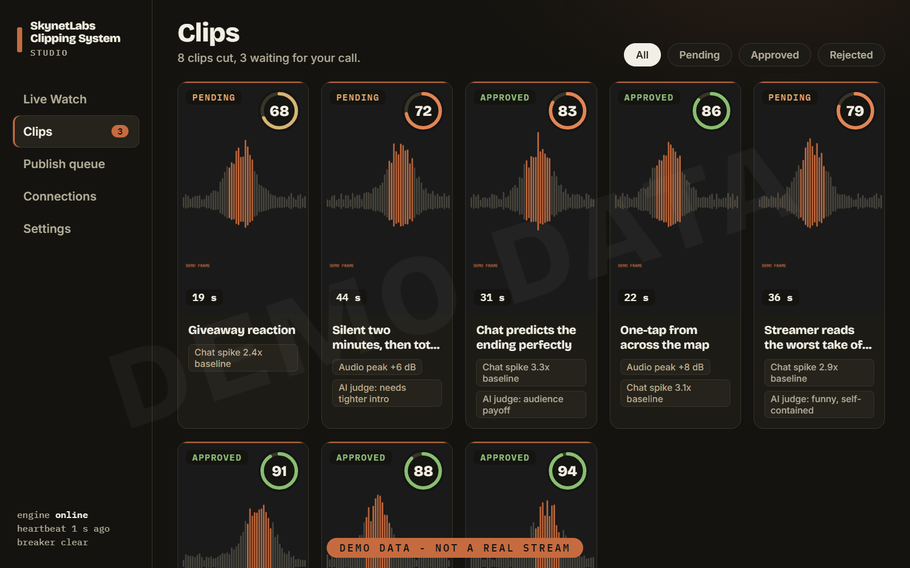

*Clips: every cut with its score, reasons and approval status.*

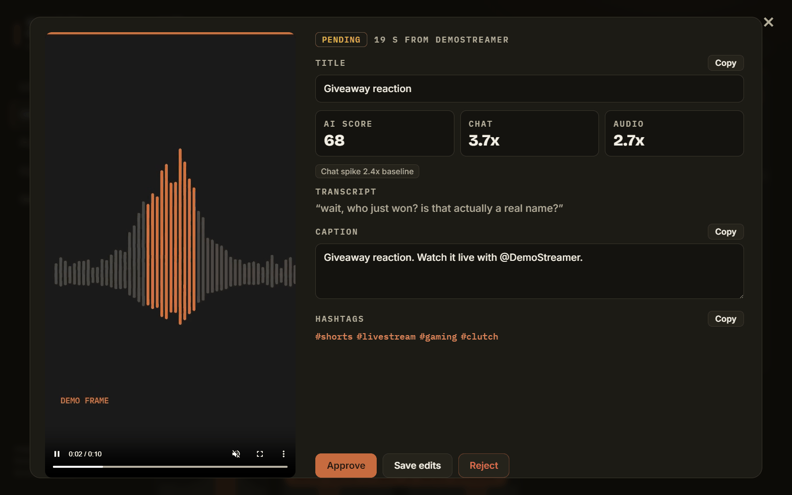

*Clip player: watch, edit the caption, approve or reject.*

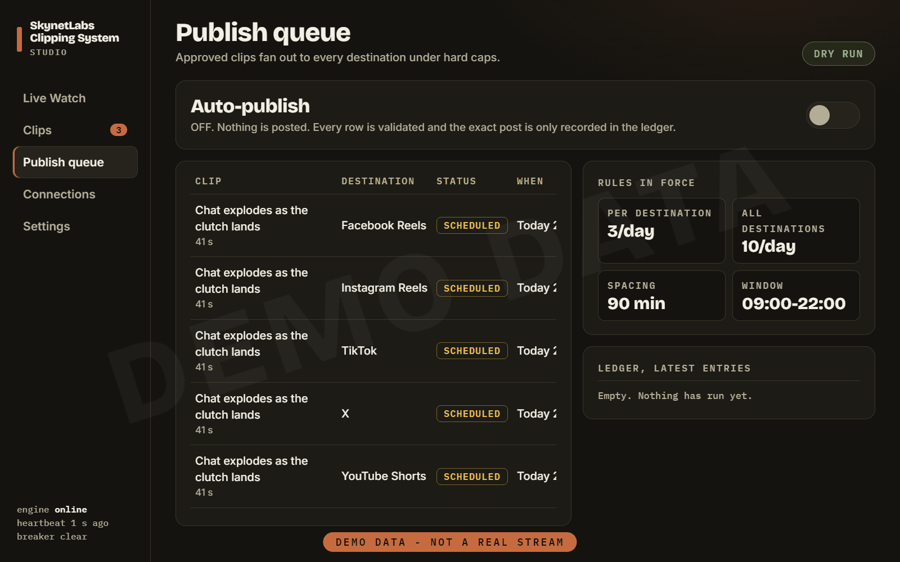

*Publish queue: the DRY RUN tag is on and auto-publish is off, so nothing is posted.*

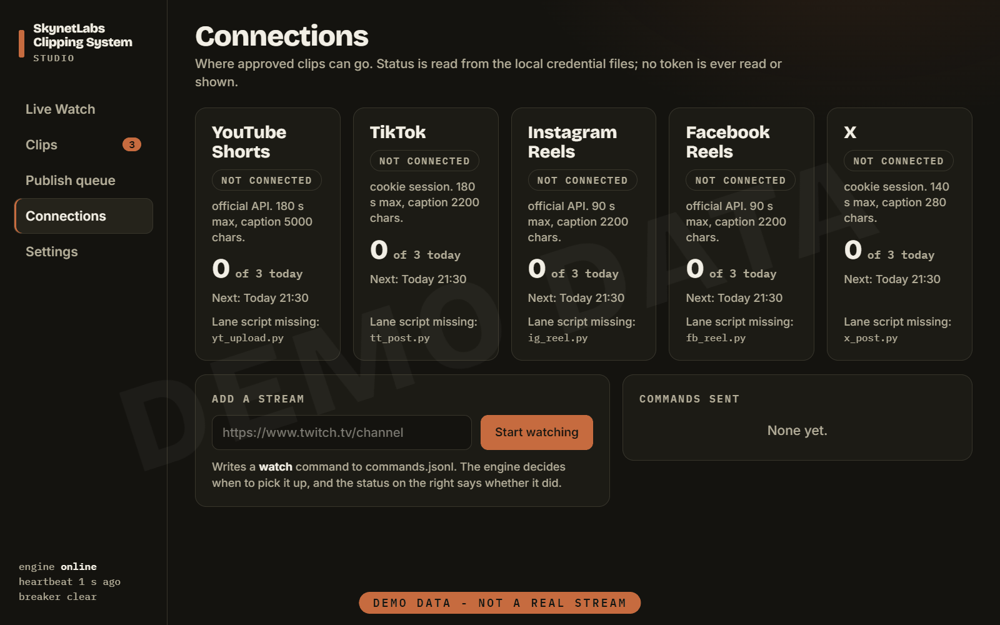

*Connections: a destination shows as connected only when its credential file exists.*

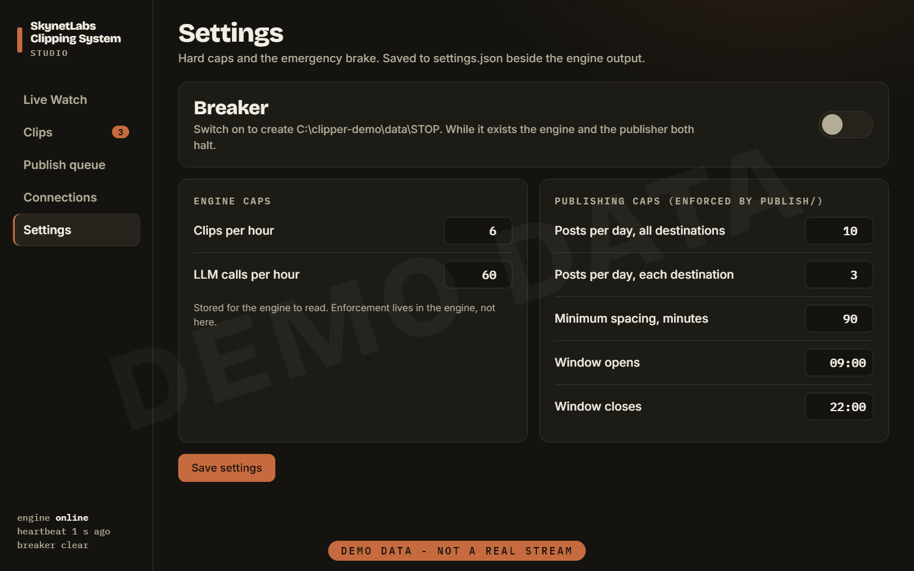

*Settings: the breaker and the hard caps.*

**Try it without an engine run:** demo mode generates synthetic data (abstract covers, no real people).

```bash
python studio/fixtures/make_fixtures.py
# Linux/macOS/Git Bash:
CLIPPER_FIXTURES=1 python studio/server.py
# PowerShell:
$env:CLIPPER_FIXTURES="1"; python studio/server.py
```

## 10. Publish queue and connecting accounts

**Default and only tested mode: dry run.** A dry run validates the clip (1080x1920, duration and size limits per platform, caption length, credit present), builds the exact payload that would be sent, and writes it to a ledger. It posts nothing.

```bash
python -m publish.cli enqueue CLIP_ID      # add an approved clip to the queue
python -m publish.cli dry-run CLIP_ID      # validate against all five destinations
python -m publish.cli schedule             # place approved clips into posting slots
python -m publish.cli tick                 # run due items (dry run)
python -m publish.cli ledger               # what happened
python -m publish.cli status               # config, breaker, queue
```

Destinations: YouTube Shorts, TikTok, Instagram Reels, Facebook Reels, X. Built-in limits: 3 posts per destination per day, 10 per day total, 90 minutes between posts on one destination, a 09:00-22:00 posting window, and a circuit breaker that opens after 2 consecutive failures on a destination. Posts are idempotent (the same clip is never posted twice to one destination).

**Connecting accounts (your own uploader).** This repo does not include uploader scripts or any credentials. For a real post you provide one script per destination, plus a credential file, in a folder outside the repo (`~/.clipper` by default, or `CLIPPER_SECRETS`):

```
~/.clipper/
  youtube.credential  tiktok.credential  instagram.credential  facebook.credential  x.credential
  lanes/yt_upload.py  tt_post.py  ig_reel.py  fb_reel.py  x_post.py
```

The Connections page shows a destination as connected when its credential file exists (the file is never read or displayed). Each script receives a job file and must post the video; use the official platform APIs where you can. Platform terms apply to you.

**Real posting needs all four at once:** `auto_publish` on in the settings, the environment variable `AUTO_PUBLISH=true`, the `--live` flag on `python -m publish.cli tick --live`, and an uploader script. Missing any one keeps it a dry run. Real posting has **not** been tested.

## 11. Safety caps and the STOP breaker

All caps live in `config.yaml`, not in prompts:

- `safety.max_steps` and `safety.max_wall_hours`: the engine halts when either is reached.
- `judge.max_calls_per_hour` and `judge.max_calls_per_stream`: hard cap on LLM calls.
- `clips.max_per_hour`: clip budget.
- Disk guard: capture stops below `ingest.min_free_gb`; segments older than `keep_segments_hours` are pruned.
- One render at a time, ffmpeg at below-normal priority with capped threads, so the machine stays usable.
- Supervisor restarts capture with backoff when the stream drops and re-resolves the stream URL on every restart.

**STOP breaker:** create an empty file `data/STOP` and the engine, the watcher and the publish queue all halt cleanly. Delete it before the next start.

```bash
touch data/STOP        # Windows: type nul > data\STOP
```

## 12. Light mode (no GPU)

```bash
python run.py --live URL --profile light
```

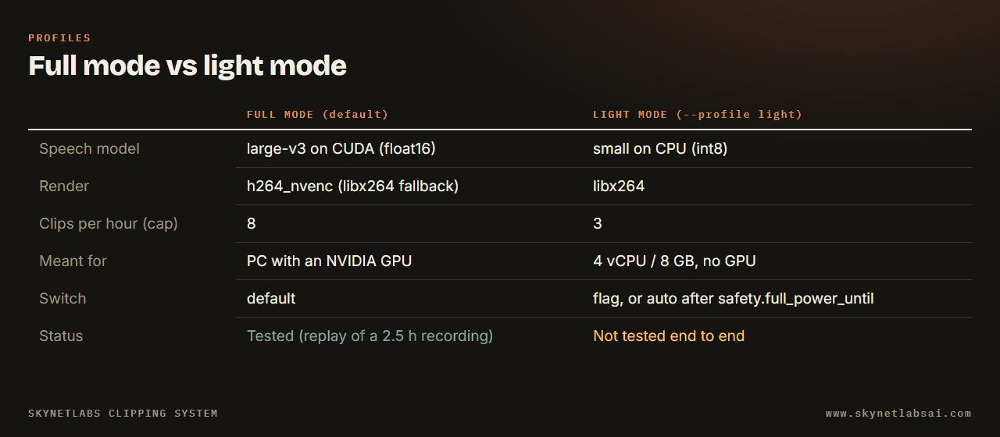

*Full mode vs light mode.*

Light mode uses the `small` speech model on CPU (int8), `libx264` and 3 clips per hour. It is meant for a 4 vCPU / 8 GB machine. You can also set `safety.full_power_until` to a timestamp: after that moment the engine switches itself to light mode (empty = never). Light mode end to end is untested.

## 13. Output files

Under `data/out/` (override with `paths.out_root`):

- `clips/<clip_id>/clip.mp4`, `cover.jpg`, `meta.json` with `{id, stream_url, streamer, stream_title, t_start, t_end, duration, created_at, score, reasons[], signals{chat_z, audio_z, llm_score}, transcript, title, caption, hashtags[], status}`
- `state.json` (rewritten every 5 s), `events.jsonl` and `signals.jsonl` (append-only)
- optional input `commands.jsonl`: `{"cmd": "watch", "url": "..."}` switches the engine to that live URL
- `python -m skynet_clipper.qa` prints a QA summary of the clips

All of `data/` is git-ignored.

## 14. Tests

```bash
pip install -r requirements-dev.txt
python -m pytest -q
```

29 tests cover spike detection, rolling z-scores, deduplication, budgets, chat parsing, judge JSON parsing and bounds, transliteration, the output contract, and the publish queue (idempotency, caps, spacing, window, breaker, STOP, the triple live gate).

## 15. Troubleshooting

| Symptom                                | Fix                                                                                                                                                  |
| -------------------------------------- | ---------------------------------------------------------------------------------------------------------------------------------------------------- |
| `ffmpeg` or `yt-dlp` not found         | install them and make sure they are on PATH (`ffmpeg -version`)                                                                                      |
| No clips appear                        | check `data/<stream_id>/engine.log`; lower `judge.min_score` or `detect.combined_trigger`; confirm chat is being read (`state.json` `chat_messages`) |
| Every clip is weak                     | the stream may simply have few moments; raise `min_score` instead of lowering it                                                                     |
| Judge never runs                       | `claude` is not on PATH or not logged in; the engine uses the fallback score and says so in `reasons`                                                |
| CUDA error or very slow speech-to-text | install the NVIDIA wheels (section 4) or use `--profile light`                                                                                       |
| Captions in the wrong language         | set `asr.language` to the stream language                                                                                                            |
| Facecam crop is wrong                  | set `render.facecam_override: [x, y, w, h]` (source pixels)                                                                                          |
| Capture stops early                    | disk guard: free space above `ingest.min_free_gb` or lower it                                                                                        |
| Engine will not start                  | a `data/STOP` file exists; delete it                                                                                                                 |
| Dashboard empty                        | the engine has not written `data/out/state.json` yet; the page shows "no engine data" until it does                                                  |
| Port 8790 busy                         | set `STUDIO_PORT`                                                                                                                                    |

## 16. FAQ

**Does it post clips by itself?** No. The engine only writes files. The publish queue is separate and dry run by default.

**Which platforms?** Input: anything yt-dlp can capture (YouTube proven, Twitch/Kick untested). Output: 9:16 files you can upload anywhere.

**Do I need a GPU?** No, but speech-to-text and rendering are much faster with one. See light mode.

**Do I need the Claude CLI?** No. Without it, scoring falls back to the deterministic signal score, which finds fewer good moments and cannot see the screen.

**Does it work for non-English streams?** The tested case was Hindi. Set `asr.language`. Hype-word lists are English plus some Hinglish; add your own in `skynet_clipper/signals.py`.

**Can it clip a stream that is not mine?** Only with permission. See below.

**How much does it cost to run?** The software is free. LLM judge calls use your Claude subscription or API usage, capped by `judge.max_calls_per_hour`.

## 17. Only clip streams you have permission to clip

Clipping someone else's stream, even with credit, can infringe their rights and break platform terms. Get the streamer's permission before you cut or post their content, credit them, and expect copyrighted music in a stream to trigger claims or mutes even when the streamer agrees. The system only helps you find moments; what you publish is your responsibility. It also flags sexual and similar content for rejection, but that filter is a helper, not a guarantee, so review every clip before posting.

## 18. Licence

MIT. See [LICENSE](LICENSE).

---

**SkynetLabs Clipping System** by SkynetLabs - [www.skynetlabsai.com](https://www.skynetlabsai.com) - [skynetjoe.com](https://skynetjoe.com) - WhatsApp [+62 813 1607 7185](https://wa.me/6281316077185)

Playbook: [The AI Stream Clipper Playbook on Etsy](https://www.etsy.com/listing/4624484141) | Free guide: [PDF](docs/Live-Stream-Clipping-Starter-Guide.pdf)
